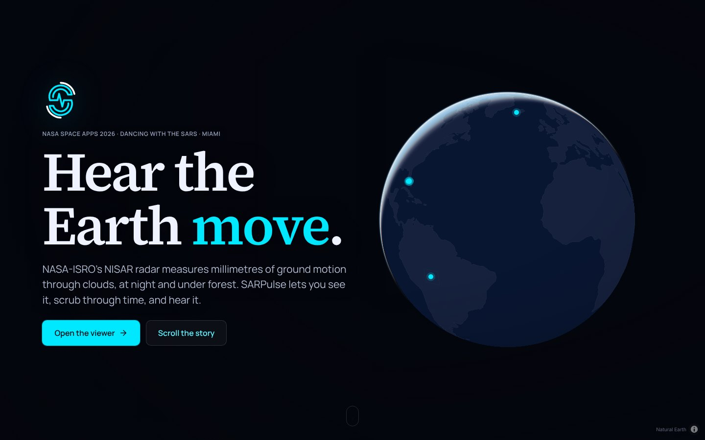
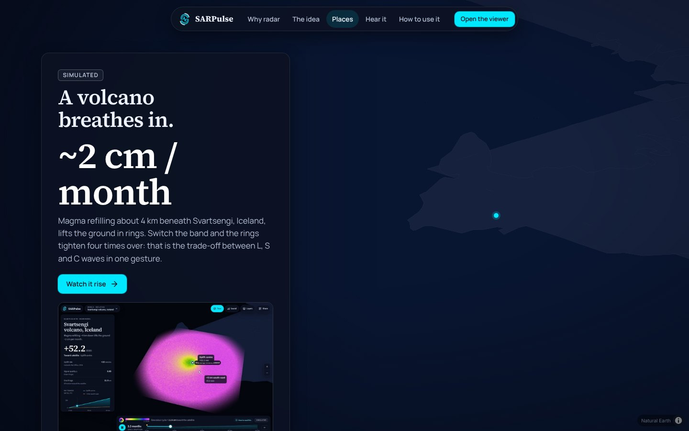
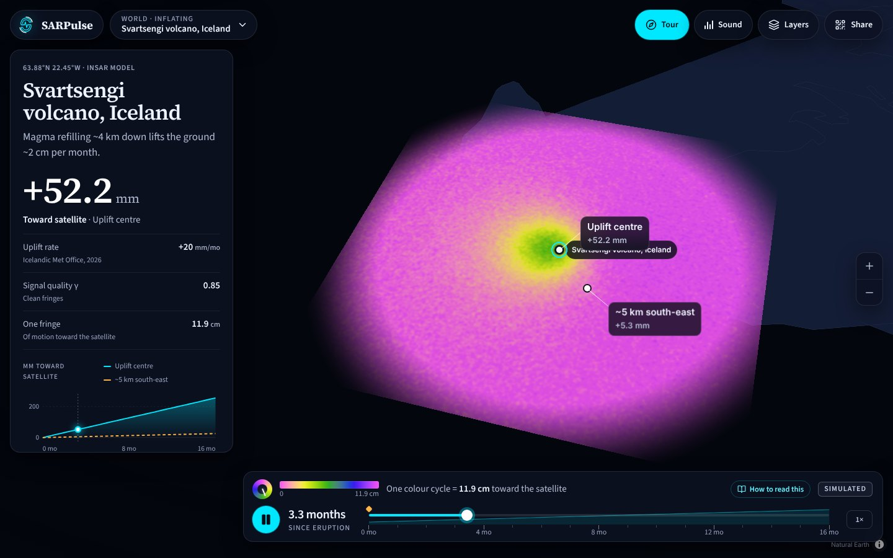
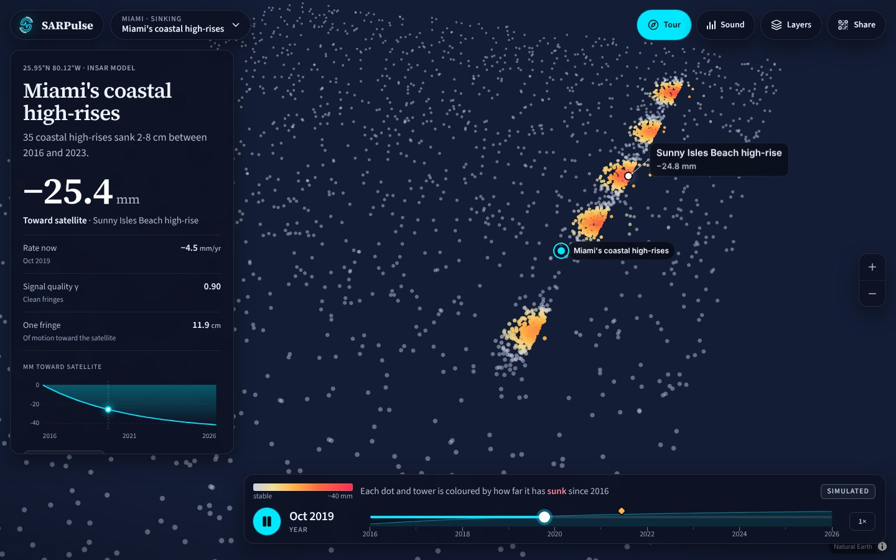
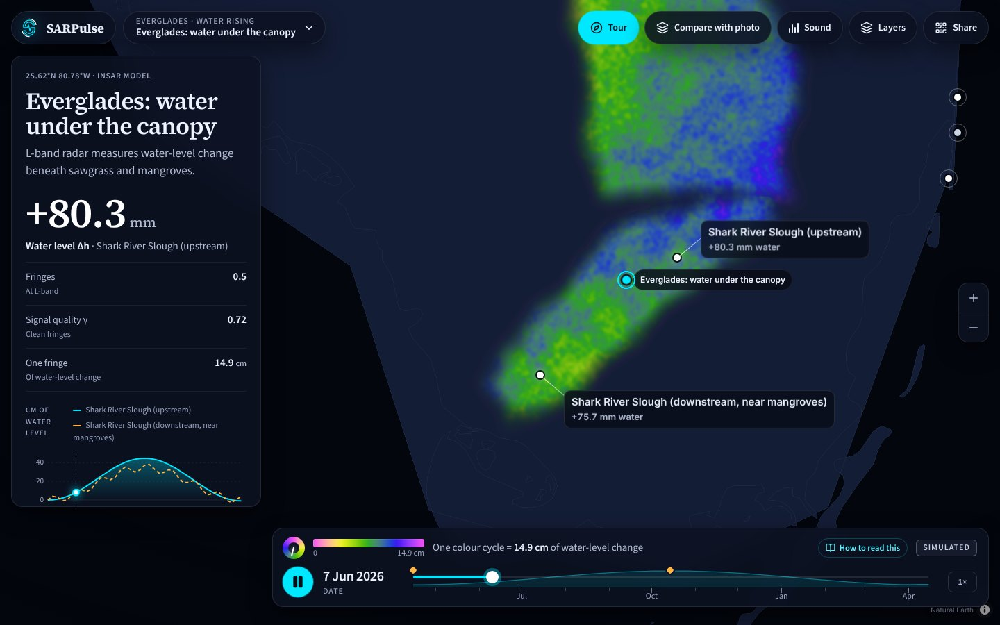
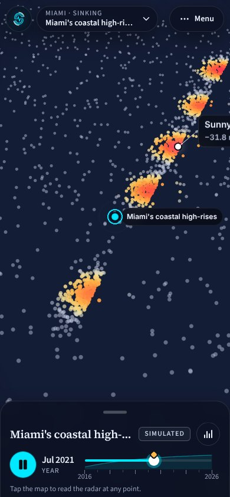
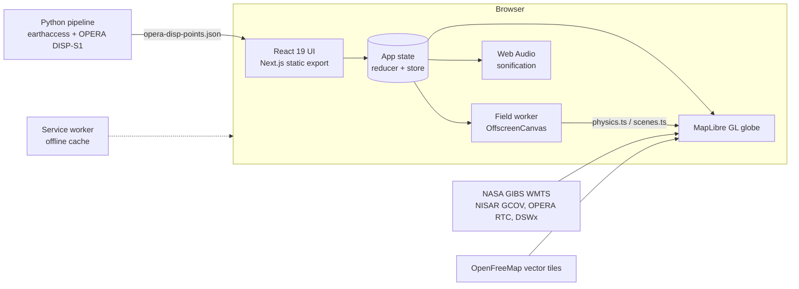
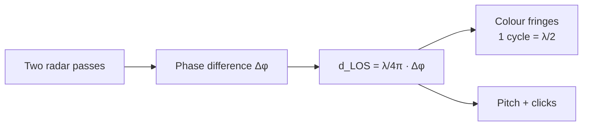

<p align="center"></p>

# SARPulse: see and hear the Earth move with NISAR radar

<p align="center">


</p>

<p align="center"></p>


**NASA International Space Apps Challenge 2026 · Challenge: _Dancing with the SARs_ · Miami local event (Miami Dade College, Padrón Campus)**
**Team MCP Lead (Miami Coral Park): Adrian Gomez · Jose Unanue** · MIT License

SARPulse turns NASA-ISRO **NISAR** synthetic aperture radar into something anyone can see, scrub through time, and hear. Radar works through clouds, at night and through vegetation, and it measures ground motion to the millimetre, which covers what optical satellites miss in South Florida:

- **Miami's coastal high-rises:** 35 buildings sank 2–8 cm between 2016 and 2023 (Aziz Zanjani et al., 2024).
- **The Everglades:** L-band radar measures water-level change *under* sawgrass and mangroves, about $15\ \text{cm}$ of water per fringe (Wdowinski et al., 2008). That is sheet-flow data for the ~USD 23 billion restoration plan.
- **Global context:** a volcano refilling in Iceland, tides flexing the Thwaites Glacier, and deforestation in the Amazon.

> **Live demo:** _add your Firebase or GitHub Pages URL here_ · works on any phone, no login.
> **Two pages:** `/` is a scroll-driven story over a 3D globe that flies to each place; `/explore/` is the interactive viewer (deep links look like `/explore/#v=world&p=iceland`).


<table>
<tr>
<td colspan="2"><br><sub><b>Scroll story:</b> the globe flies to each place as you read; a capsule nav slides in below the hero.</sub></td>
</tr>
<tr>
<td width="50%"><br><sub><b>Iceland:</b> magma refilling lifts the ground ~2 cm a month; each colour cycle is 11.9 cm.</sub></td>
<td width="50%"><br><sub><b>Miami:</b> persistent-scatterer points coloured by how far each sank since 2016.</sub></td>
</tr>
<tr>
<td><br><sub><b>Everglades:</b> L-band sees water level change under the canopy, 14.9 cm per fringe.</sub></td>
<td align="center"><br><sub><b>Phone:</b> draggable bottom sheet, tap to read the radar.</sub></td>
</tr>
</table>

## Contents
[Real vs simulated](#what-is-real-and-what-is-simulated) · [Features](#features) · [Physics](#the-physics) · [System diagram](#how-the-pieces-fit) · [Code layout](#architecture) · [Run it](#quick-start) · [Docs](docs/)

## How the pieces fit





---

## What is real and what is simulated

We label every layer in the app, because judges and users deserve to know.

| Tag | Meaning |
| --- | --- |
| **LIVE** | Real NASA imagery streamed at view time from NASA GIBS, no login: **NISAR L-band GCOV** (`NISAR_L2_Geocoded_Polarimetric_Covariance`), **OPERA Sentinel-1 RTC** backscatter, **OPERA DSWx-S1** radar water maps. The app searches back day by day for the latest pass over the area. |
| **MODEL** | Interferograms computed in the browser from physics models (Mogi volcanic source, elastic-beam tidal flexure, construction creep, wetland double bounce), **calibrated to the published studies** cited in the app. They teach how InSAR works; they are not processed NISAR interferograms. |
| **MEASURED** | Optional: measured OPERA **DISP-S1** line-of-sight velocities for Miami Beach, extracted by our Python pipeline (`pipeline/fetch_real_data.py`) with a free NASA Earthdata login. |
| **INFO** | Context with sources, no data layer (e.g. Surfside). |

### Surfside, handled honestly
InSAR detected **no settlement at Champlain Towers South before the 2021 collapse** (Aziz Zanjani et al., 2024). NIST's June 2026 technical findings point to punching-shear failure under the pool deck. SARPulse therefore presents radar as a **screening tool that tells inspectors where to look first**, alongside Florida's SB 4-D milestone inspections, never as a collapse predictor.

---

## Features

- **A 3D globe you fly across.** MapLibre GL renders the Earth with an atmosphere, shaded relief from space and crisp OpenStreetMap vector detail up close. The first visit opens on the spinning globe; each place is a cinematic flight.
- **A guided 90-second story** (five chapters) for anyone who has never heard of InSAR, plus free exploration with a place picker.
- **Physics-based interferograms that respond to the radar band:** NISAR L ($11.9$ cm per colour cycle), NISAR S ($4.7$ cm), Sentinel-1 C ($2.8$ cm), SAOCOM L ($11.8$ cm). Shorter waves give denser fringes and, over vegetation, lose coherence: watch C-band fall apart over the Everglades while L-band stays clean.
- **Full resolution, clipped by the real coastline.** Fields are painted in a Web Worker (up to a megapixel per frame) and drawn *under* OpenStreetMap's water polygons, so every coast cuts the data exactly, at any zoom.
- **Miami as urban InSAR is actually published:** a cloud of persistent scatterers (rooftops, balconies) coloured by how far each has sunk.
- **Compare with the photo:** an optional split between an optical photo (sees leaves) and radar (sees the water below).
- **Earth sonification (Web Audio):** pitch follows ground motion under the cursor, each fringe crossed clicks, and low coherence adds hiss. **Hear this place** plays a site's history as a melody.
- **Time scrubbing and Play** with event markers: 2016–2026 creep in Miami, a year of Everglades water, 16 months of Icelandic uplift, the spring–neap tide at Thwaites.
- **Evidence on every place:** citations with links, and metrics computed from the same model the map draws.
- **Deep links** (`#v=world&p=iceland&b=sentinel-c&d=fringes`), **QR share**, an **installable PWA**, and an **offline basemap** (Natural Earth) if venue Wi-Fi drops.
- **No API keys anywhere:** OpenFreeMap vector tiles, Esri imagery and NASA GIBS are all keyless.
- **Accessible:** keyboard-operable controls, ARIA labels, reduced-motion support, AA-contrast dark theme.

## The physics

Every formula below is implemented in `src/lib/physics.ts` and `src/lib/scenes.ts` and covered by unit tests. The same equations are typeset with MathJax inside the app (**About → The math**).

**Phase to motion.** Two radar passes differ in phase by $\Delta\phi$. The ground motion along the line of sight, $d_{\mathrm{LOS}}$ (positive *toward* the satellite, so it equals minus the range change $\Delta R$), is

$$d_{\mathrm{LOS}} = -\Delta R = \frac{\lambda}{4\pi}\,\Delta\phi, \qquad \lambda = \frac{c}{f},$$

so one full colour cycle ($\Delta\phi = 2\pi$) is $d_{2\pi} = \lambda/2$: $11.9\ \text{cm}$ for NISAR L-band ($f = 1.257\ \text{GHz}$, $\lambda \approx 23.8\ \text{cm}$).

**Line of sight.** A ground displacement $\mathbf{u} = (u_e, u_n, u_u)$ is seen only along the unit vector $\hat{\mathbf{s}}$ from the ground to the satellite (incidence $\theta \approx 37^\circ$, azimuth $\alpha$). For a right-looking satellite on an ascending pass with heading $h = -12^\circ$ the beam points to heading $h + 90^\circ$, so the satellite lies on the opposite side: $\alpha = h - 90^\circ = -102^\circ$, giving $\hat{\mathbf{s}} \approx (-0.589,\ -0.125,\ 0.799)$ in (east, north, up):

$$d_{\mathrm{LOS}} = \mathbf{u}\cdot\hat{\mathbf{s}}, \qquad \hat{\mathbf{s}} = \left(\sin\theta\sin\alpha,\ \sin\theta\cos\alpha,\ \cos\theta\right).$$

**Wetland double bounce.** In the Everglades the pulse reflects off the water and then the stems, so a water-level change $\Delta h$ changes the two-way path by $2\,\Delta h\cos\theta$, which is an equivalent line-of-sight motion $d_{\mathrm{LOS}} = \Delta h\cos\theta$:

$$\Delta h_{2\pi} = \frac{\lambda}{2\cos\theta} = \frac{11.9\ \text{cm}}{\cos 37^\circ} \approx 14.9\ \text{cm},$$

which matches the ~15 cm per L-band fringe published by Wdowinski et al. (2008).

**Volcano (Mogi, 1958).** Uplift above a point source at depth $d$ that gains volume $\Delta V$ (Poisson ratio $\nu = 0.25$):

$$u_z(r) = \frac{(1-\nu)\,\Delta V}{\pi}\,\frac{d}{\left(r^2 + d^2\right)^{3/2}},$$

with $\Delta V$ growing linearly in time to reproduce Svartsengi's ~2 cm/month at $d = 4\ \text{km}$.

**Building settlement (construction creep).** Each Miami high-rise cluster settles fast at first, then slows:

$$s(t) = v_0\,\tau\left(1 - e^{-t/\tau}\right), \qquad \dot s(t) = v_0\, e^{-t/\tau},$$

spread over a Gaussian bowl $\exp\!\left(-\tfrac{x^2+y^2}{2\sigma^2}\right)$ around each source.

**Ice-shelf tidal flexure (Holdsworth, 1969).** Across the Thwaites grounding line ($x > 0$ seaward, flexural length $\ell$, tide amplitude $A$):

$$w(x) = A\left[1 - e^{-x/\ell}\left(\cos\frac{x}{\ell} + \sin\frac{x}{\ell}\right)\right].$$

**Decorrelation noise.** Coherence $\gamma$ (by band and surface, after Kim et al., 2013) sets the phase noise for $L$ looks (Cramér–Rao bound):

$$\sigma_\phi = \sqrt{\frac{1-\gamma^2}{2L\gamma^2}}.$$

**Fast, exact rendering.** Every scene is separable in time, so the renderer precomputes spatial bases $B_k$ once and re-weights them each frame:

$$d_{\mathrm{LOS}}(\mathbf{x}, t) = \sum_{k} c_k(t)\, B_k(\mathbf{x}),$$

and a unit test checks this against the reference model at random points to $10^{-9}$.

**Sonification.** With $s = \tanh\!\left(1.4\,d_{\mathrm{LOS}} / S\right) \in [-1, 1]$ for a scene's full-colour scale $S$, the pitch is

$$f(s) = \begin{cases} 110 \cdot 2^{s}\ \text{Hz}, & s < 0 \ \ (\text{sinking} \to 55\ \text{Hz}) \\ 110 \cdot 2^{2s}\ \text{Hz}, & s \ge 0 \ \ (\text{rising} \to 440\ \text{Hz}) \end{cases}$$

and every $2\pi$ of phase crossed under the cursor plays a click.

## Code layout

```
src/
  lib/physics.ts           InSAR core: bands, phase ↔ LOS, Mogi, tidal flexure, creep, coherence, colour maps
  lib/scenes.ts            Calibrated scenes + their separable form (time weights × spatial bases)
  lib/fieldRaster.ts       Full-resolution painter: bases computed once, separable, so a frame is a few multiply-adds per pixel, colour LUTs
  workers/field.worker.ts  Paints frames off the main thread, returns ImageBitmaps (zero-copy transfer)
  lib/psPoints.ts          Miami persistent-scatterer cloud (deterministic, two-source weights per point)
  lib/mapStyle.ts          Basemap: OpenFreeMap vectors in the logo palette, relief, globe + atmosphere;
                           radar layers sit between land and water so the coastline masks them exactly
  lib/gibs.ts              NASA GIBS tiles + latest-pass search (parallel probes, memoised, cached 6 h)
  lib/sonifier.ts          Web Audio engine (pitch / hiss / fringe ticks / melodies)
  lib/appState.ts          Single typed reducer: every UI transition is a pure, tested function
  lib/content.ts           Places, live layers and references (single source of truth)
  lib/equations.json       The math shown in the app, typeset to SVG by MathJax at build time
  components/              React 19 UI: Workspace, MapView (MapLibre bridge), place card, dock, tour, modals
  components/landing/      Home page: scroll chapters, globe stage (camera per chapter), capsule nav, interactive fringe demo
  lib/prefetch.ts          Warms the tile cache for the tour places (globe tiles, Miami, Everglades, ...) on idle
scripts/
  vendor.mjs               Self-hosts the pinned MapLibre build from node_modules (no CDN)
  build-math.mjs           MathJax TeX → SVG at build time (no MathJax runtime shipped)
  build-sw.mjs             Service worker with a content-hashed precache list
pipeline/
  fetch_real_data.py       OPERA DISP-S1 → measured velocities (earthaccess, HTTP range reads, mini-stack chaining)
  tests/                   Pure-function tests (no network, no credentials)
```

Performance choices: a fully **static export** (any CDN; no server). Radar fields are **separable in time**, so each frame is a few multiply-adds per pixel in a **Web Worker**, handed to the GPU as an `ImageBitmap` and uploaded once per frame. Map work never re-renders React (the cursor readout subscribes to its own store). The chart is dependency-free SVG, icons are ~20 inline SVGs, and MapLibre loads lazily from our own origin only when the map mounts.

## Quick start

**Windows, one click:** double-click `setup-windows.cmd`. It installs uv, Python 3.12 and Node.js LTS (only if missing), runs every test, optionally fetches the real NASA data, and opens the site.

**Any OS:**
```bash
npm ci
npm run dev            # http://localhost:3000
npm run check          # typecheck + lint + tests + production build
npm run test:py        # Python pipeline tests (needs uv)
npm run data           # fetch measured OPERA DISP-S1 velocities (Earthdata login)
```

## Deploy
- **Firebase Hosting:** `npm i -g firebase-tools` → `firebase login` → `firebase use --add` (pick or create your project) → `npm run deploy`.
- **GitHub Pages:** push to `main`; `.github/workflows/pages.yml` builds with the right base path and publishes.

See [`docs/DEPLOY.md`](docs/DEPLOY.md) for click-by-click steps.

## Science and data references
Every number in the app is tied to a source in `src/lib/content.ts` and is shown in the app's **About** panel and on each place card. Key sources:

- ASF DAAC: NISAR data availability. Calibrated L-band products public since July 20, 2026.
- Aziz Zanjani, Amelung et al. (2024), *Earth and Space Science*: construction-induced subsidence on Miami's barrier islands.
- Fiaschi & Wdowinski (2020), *Ocean & Coastal Management*: 1–3 mm/yr subsidence on reclaimed wetlands in Miami Beach.
- Wdowinski et al. (2008), *Remote Sensing of Environment*; FIU Geodesy Lab: wetland InSAR, one L-band fringe $\approx 15\ \text{cm}$ of water.
- Kim et al. (2013), *IEEE TGRS*: Everglades coherence by band.
- Icelandic Meteorological Office (2026): Svartsengi uplift ~2 cm/month, source ~4 km deep.
- Rignot et al. (2014), *GRL*: Thwaites grounding-line retreat from DInSAR.
- NIST (June 2026): Champlain Towers South technical findings. Florida SB 4-D (2022).
- Congressional Research Service IF11336: CERP ~USD 23.2 B (FY2020 dollars).
- NASA GIBS; NASA OPERA DISP-S1, DSWx-S1, RTC-S1; Natural Earth.

## Use of AI
We used **Claude (Anthropic)** as a coding and research assistant. It fact-checked our claims against current sources, wrote and refactored much of the TypeScript and Python, wrote tests, and drafted documentation. **Our team** chose the challenge and the Miami focus, decided what the app should show (photo-versus-radar comparison, sonification, Surfside framing), reviewed and tested every feature, and can explain the physics. No NASA logos or flags were generated or modified with AI.

## Team
**MCP Lead** (Miami Coral Park): **Adrian Gomez** and **Jose Unanue** (Team Owner).

## License
MIT. Third-party: MapLibre GL JS (BSD-3), Lucide icon subset (ISC), qrcode-generator (MIT), Source Serif 4 and Manrope (SIL OFL 1.1). The interface font Sofia Pro is licensed and is not in this repository: put your licensed `sofia-pro-{300,400,500,600,700}.woff2` files in `public/fonts/sofia/` to use it, otherwise the site falls back to the bundled Manrope, MathJax (Apache-2.0, build time only), Natural Earth (public domain). Map data © OpenStreetMap contributors via OpenFreeMap (no API key); imagery © Esri, Maxar, Earthstar Geographics; NASA GIBS imagery courtesy NASA ESDIS.
